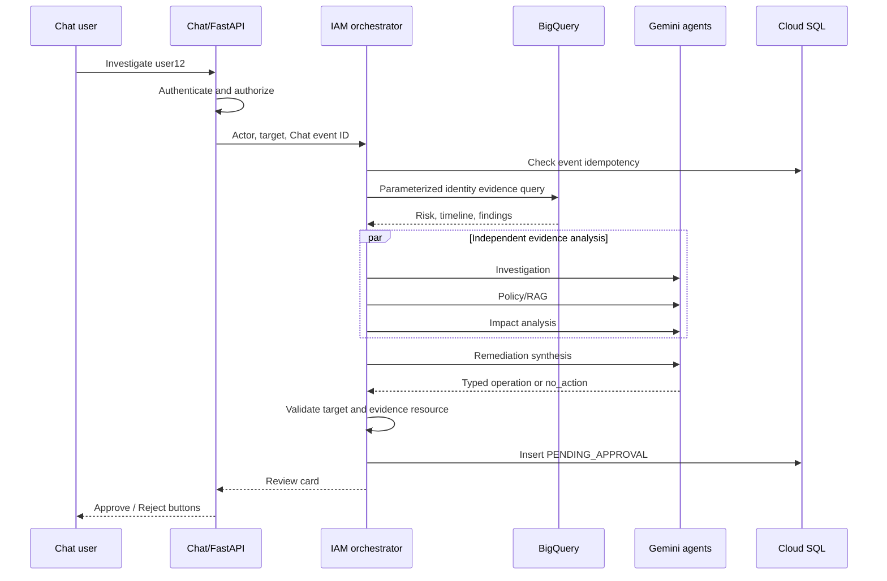
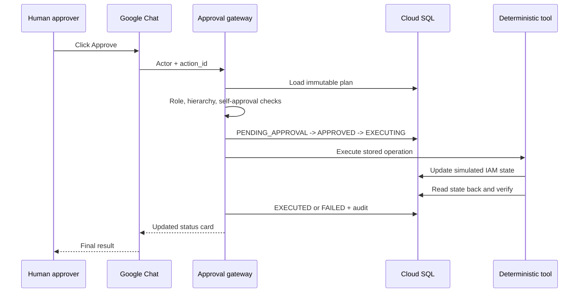
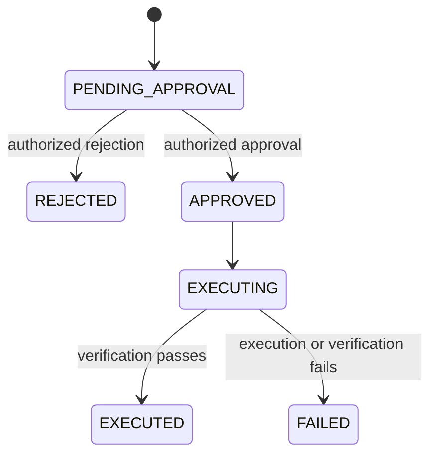

# IAM Agent Platform Architecture

## Responsibility split

| Layer | Responsibility | May write? |
|---|---|---:|
| `IAM_NEW_1` | Ingest events, run Spark detections, build BigQuery analytics | BigQuery only |
| Google Chat + FastAPI | Accept user requests and approval clicks | No IAM systems |
| Authorization | Map actor role/scope and target hierarchy | No |
| IAM orchestrator | Collect evidence and coordinate Gemini agents | Action proposal only |
| Cloud SQL | Operational action state, decisions, audit, simulated state | Yes |
| Approval gateway | Enforce human authorization and state transitions | Cloud SQL only |
| Deterministic executor | Run exactly the approved operation | Simulated IAM only |

BigQuery is the analytical plane. Cloud SQL is the operational control plane. Keeping them
separate prevents chat retries or agent reasoning from mutating analytics.

## Investigation-to-recommendation sequence

The three analysis calls are independent once the evidence bundle exists, so they run via
`asyncio.gather`. Remediation is dependent on all three and runs afterward. This is
concurrency for latency; it is not a set of long-running agent threads or microservices.

## Approval-to-verification sequence

## Action state machine

Conditional SQL updates enforce these transitions. Replayed button clicks return the
terminal record and cannot run the tool twice.

## Agent contracts

| Agent | Inputs | Output | Explicitly cannot do |
|---|---|---|---|
| Investigation | Risk profile, anomaly rows, timeline | Findings with table + finding ID | Execute changes |
| Policy/RAG | Retrieved policy chunks and risk summary | Controls with exact chunk IDs | Invent policies |
| Impact analysis | Evidence bundle | Blast radius, urgency, action/inaction risks | Select a tool |
| Remediation | Three assessments and target identity | One typed plan or `no_action` | Approve or execute |

Gemini structured output is validated with Pydantic. Prompts delimit evidence and instruct
the model to treat retrieved values as data rather than instructions.

## Authorization hierarchy

`config/authorization.yaml` assigns every Chat principal a role and a scope. An actor may
act only when their scope is an ancestor of the target identity's path from
`config/identities.yaml`.

Example:

| Actor scope | Target scope | Result |
|---|---|---|
| `/company/finance` | `/company/finance/manager` | In scope |
| `/company/finance` | `/company/engineering/manager` | Denied |
| `/` | Any normalized target path | In scope |

Paths are compared by segments, so `/company/fin` is not an ancestor of
`/company/finance`.

## BigQuery contract with IAM_NEW_1

The evidence adapter reads the user-scoped outputs defined by
`IAM_NEW_1/spark_job/detections.py`. Every query uses `@target_user` and `@row_limit`. Table
identifiers come only from a source-code tuple; neither the user nor Gemini can select an
arbitrary table.

Global aggregations such as `ad_volume_spikes` and `ad_group_churn_rate` are intentionally
not pulled into a single-user investigation because they do not have a reliable `user`
filter.

## Trust boundaries

- Cloud Run verifies the Google-signed request before FastAPI handles it when the service
  is private and `chat@system.gserviceaccount.com` is the invoker.
- The event's Workspace user is then authorized separately. Request authentication does
  not imply user permission.
- BigQuery credentials are read-only for data; Cloud SQL credentials own action state.
- The LLM cannot submit SQL, decide approval, change an existing plan, or invoke IAM tools.
- Group/entitlement operations are rejected unless their exact resource is present in the
  collected evidence.
- The requestor cannot approve their own action, even if they also hold an admin role.
- Audit rows capture creation, decision, execution, and verification.
