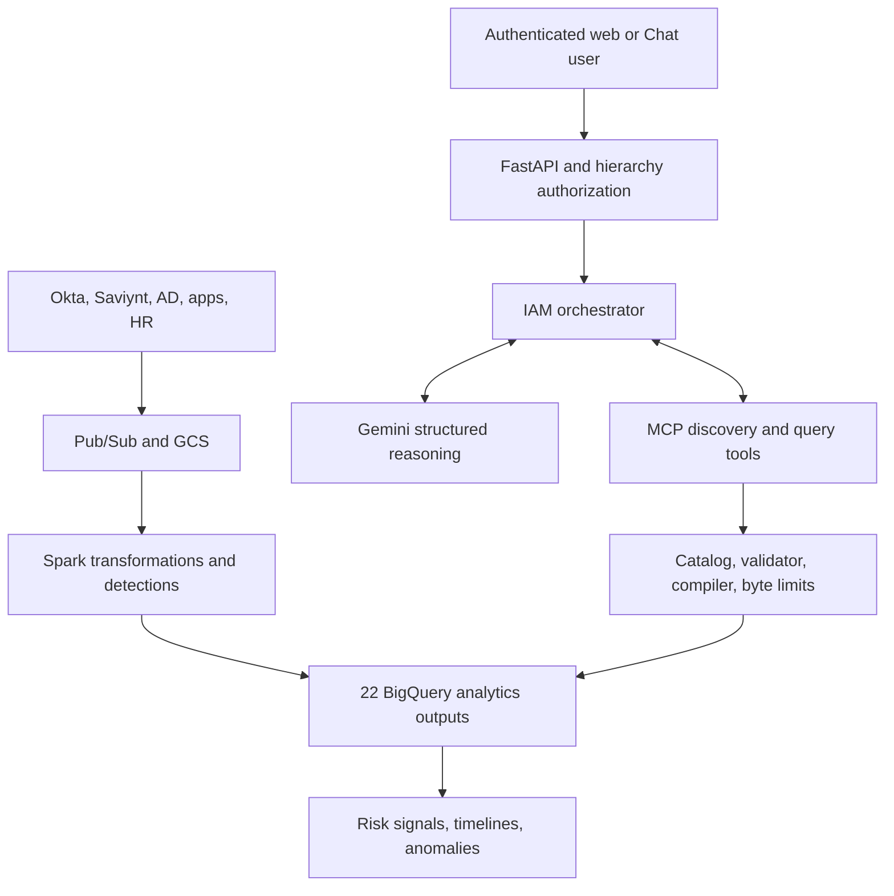

# Technical architecture

## Design goal

The application should feel like a general conversational IAM analyst while preserving a hard
boundary: an LLM may decide *what approved evidence would answer a question*, but deterministic
application code decides *whether that request is valid and exactly which SQL may run*.

The system therefore separates reasoning, semantic metadata, query construction, execution,
and narration. No single Gemini response is treated as executable code.

## End-to-end data flow



`IAM_NEW_1` owns ingestion, transformation, detection, and BigQuery output creation. This
repository owns authenticated read-only exploration of those outputs.

## Startup sequence

When a Cloud Run instance starts, `iam_agent/api.py` constructs the dependency graph:

1. Load settings, the principal allowlist, identity hierarchy, policy text, and semantic catalog.
2. Create the catalog retriever, evidence coverage validator, query validator, compiler, and
   BigQuery executor. Validate the catalog's topic-to-concept references at startup.
3. Place those components behind `IAMEvidenceService`.
4. Register the service's four tools on an official `MCPServer`.
5. Give the orchestrator an official MCP `Client`, a Gemini planner, an answerer, and bounded
   conversation memory.
6. Create deterministic report exporters and a bounded, 15-minute in-memory download store.
7. During FastAPI lifespan startup, call MCP `list_tools` and `list_iam_domains`. Startup fails
   if the expected tool contract is incomplete.

The MCP transport is in-process. That is an intentional deployment choice, not a mock: tool
registration, discovery, schemas, serialization, and calls still go through the official MCP
SDK. There is one Cloud Run service and no separately exposed MCP endpoint.

## Per-message sequence

```mermaid
sequenceDiagram
    participant F as Authenticated interface
    participant O as Orchestrator
    participant G as Gemini
    participant M as MCP service
    participant B as BigQuery

    F->>F: Verify Google token
    F->>O: Question + verified principal + conversation key
    O->>O: Require query permission
    O->>M: search_iam_catalog(question, history, principal)
    M->>M: Search all concepts; derive topic requirements
    M-->>O: Candidate schemas across multiple domains
    O->>M: list_iam_domains (cached)
    M-->>O: Five cards describing all 22 concepts
    O->>G: Question + history + retrieved schemas + domain cards
    G-->>O: QuestionDecomposition
    alt Project data is required
        O->>G: Plan using candidates + evidence requirements
        G-->>O: Semantic steps, no SQL
        O->>M: run_iam_query(principal, question, history, plan)
        M->>M: Recompute coverage; validate scope, catalog, limits
        opt Plan rejected
            M-->>O: Typed rejection reason
            O->>M: describe_iam_domains(all domains)
            M-->>O: Entire catalog for bounded repair
            O->>G: Repair once with full catalog + rejection
            G-->>O: Corrected semantic plan
            O->>M: Validate corrected plan from the beginning
        end
        M->>M: Compile parameterized SELECT
        M->>B: Dry run
        B-->>M: Estimated bytes
        M->>B: Execute within byte ceiling
        B-->>M: Rows
        M-->>O: EvidenceBundle
        O->>G: Question + plan + evidence
        G-->>O: Grounded AnalystAnswer
    else General IAM question
        O->>G: General answer without project claims
        G-->>O: AnalystAnswer
    end
    opt Browser requested report formats
        O->>O: Render deterministic report files
    end
    O-->>F: Answer + sources + caveats + file descriptors
```

The orchestrator—not Gemini—owns every MCP call. Gemini receives domain metadata or evidence as
input to a structured-output request. It has no Google Cloud credential and no direct database
or MCP transport handle.

## Retrieval before domain selection

The original question reaches `search_iam_catalog` before any model call. The deterministic
retriever searches all 22 concepts using names, descriptions, entities, grain, synonyms, fields,
and metrics. Explicit topic aliases in `config/semantic_catalog.yaml` add stronger matches.
Long alphabetic tokens tolerate close spelling mistakes; identity values are not fuzzy-matched.
An explicit follow-up carries the previous turn's identities and, when needed, its topic.

The result contains multiple candidate concepts and their detailed schemas, derived domain
labels, reasons, and evidence requirements. Specific questions retain up to eight scored
candidates plus every concept needed by matched topics. Broad identity profiles and low-confidence
retrieval retain all 22. This is metadata retrieval: no BigQuery rows are scanned at this stage.
Authorized rows are retrieved after plan validation and dry-run cost checks, before narration.

Gemini sees the retrieved fields and metrics before classifying the question. Its domain labels
are descriptive and no longer determine which schemas the query planner is allowed to see.
Strong retrieval evidence also prevents a named identity question from being treated as general
knowledge just because Gemini omits a domain or produces an invalid decomposition.

## Deterministic evidence coverage and repair

SQL safety alone cannot detect a safe query against the wrong business data. After the existing
query validator runs, `EvidenceCoverageValidator` checks the plan against requirements recomputed
inside MCP from the original question and bounded history, rather than model-supplied labels.

| Question | Independent requirement | Rejected example |
| --- | --- | --- |
| Authentication anomalies | At least one approved authentication detection concept | Only `stale_access` from provisioning |
| MFA bypasses and stale access | Evidence for both matched topics | Only the MFA table |
| Which users are riskiest, and why? | `risk_scores` records including `risk_factors` | An aggregate maximum with no explanatory factors |
| Tell me about user12 | Risk scores and timeline evidence, with exact identity filters on every step | Unfiltered company-wide records or only a risk aggregate |

Malformed model output or a rejected plan gets one repair attempt with the entire catalog and
the exact validation reason. The repaired plan passes every check again. Repeated rejection
executes no rejected SQL. Permission, quota, unavailable-service, missing-table, and byte-budget
failures are dependency errors; they do not trigger semantic replanning or weaker validation.
Successful independent steps can still produce a partial answer, with failed sources explicitly
listed in caveats. Only successful tables can appear as evidence sources.

These checks cover the maintained catalog topics, not every possible interpretation of natural
language. Unrecognized vocabulary keeps the complete catalog available; ambiguous intent can
still require clarification. Adding an output means updating its schema and topic aliases in the
catalog and testing the intended evidence requirements. A larger catalog may later need hybrid
lexical/vector retrieval, but retrieval scores must never grant authorization.

| Implementation | Responsibility |
| --- | --- |
| `config/semantic_catalog.yaml` | Versioned meanings, schemas, aliases, and topic-to-concept mapping |
| `iam_mcp/retrieval.py` | Candidate ranking, broad fallback, topic and identity coverage checks |
| `iam_agent/orchestrator.py` | Retrieval-first sequence, one repair, dependency error handling |
| `iam_agent/gemini_contracts.py` | Provider-friendly structured output converted to strict application models |
| `iam_mcp/validator.py` and `compiler.py` | Scope and SQL safety, parameterized SQL generation |
| `iam_mcp/bigquery_executor.py` | Dry runs, bounded reads, classified upstream failures |

The Gemini wire contract encodes a filter value as a JSON string to avoid a deeply branching
provider schema. The adapter decodes that value and runs the full application model validation.
This changes only the provider boundary; the MCP semantic plan still uses typed filter values.
Every failed request is logged with a reference, workflow stage, error code, and original
exception chain. The browser receives the safe category and reference, not the raw traceback.

## Historical data and common ranking plans

`iam_mcp/time_policy.py` applies the date policy inside the authorized MCP query boundary.
Without an explicit period in the original question, it clears `time_range_days` and filters on
catalog fields typed as dates or timestamps. All retained history remains eligible. An explicit
date, year, relative period, or reference to a previously stated period preserves date filters.
The former maximum-lookback configuration is no longer used. Row, step, byte, and identity scope
checks run on the resulting plan before compilation. Each evidence result records the actual
filters and relative window applied, and the bundle reports its time scope for narration/exports.

`iam_agent/standard_plans.py` recognizes a narrowly bounded, unconstrained highest-risk ranking.
It constructs a semantic plan using the catalog's `maximum_risk_score` metric grouped by `user`,
descending score order, an identity tie-break, and a bounded result limit. For "and why", ordered
risk records include contributing factors. Requests containing dates, named users, departments,
applications, or other unfamiliar constraints go through Gemini's normal planning path. This
does not introduce raw SQL or replace the general analyst with a list of canned questions.
Standard plans pass through the same MCP time, scope, coverage, and byte checks as model plans.

Structured-output repair now receives the failing field paths and validation reasons rather
than a generic invalid-output message. Raw model output and filter values are excluded from that
diagnostic summary. A planning failure must not be blamed on an empty BigQuery time window:
the query has not run at that stage. An empty scoped query also does not prove the whole table
contains no data. The answerer uses the executed query's scope to explain these distinctions.

## How a question becomes SQL

Consider: "Show the ten riskiest Finance users."

Gemini receives business vocabulary from MCP and may produce a plan equivalent to:

```json
{
  "objective": "Rank Finance identities by risk",
  "steps": [
    {
      "step_id": "rank_finance_risk",
      "purpose": "Return the ten highest observed risk scores",
      "concept": "risk_scores",
      "operation": "rank",
      "fields": [],
      "metrics": ["maximum_risk_score"],
      "dimensions": ["user"],
      "filters": [
        {"field": "department", "operator": "equals", "value": "finance"}
      ],
      "time_range_days": null,
      "order_by": [],
      "limit": 10
    }
  ]
}
```

That JSON contains no dataset, table identifier, SQL expression, join, or IAM operation. The
trusted catalog maps `risk_scores` to one fixed table and maps `maximum_risk_score` to
`MAX(t.risk_score)`. The compiler derives `department` from `config/identities.yaml`, adds the
authenticated user's allowed identities, creates BigQuery parameters, and emits the final
query. User strings never become SQL identifiers or SQL fragments.

## Semantic vocabulary

| Term | Technical meaning | BigQuery relationship |
| --- | --- | --- |
| Domain | Business label derived from retrieved candidates | Groups relevant outputs without acting as a single model-selected gate |
| Concept | Governed analytical object | Maps one-to-one to an allowlisted output table, such as `risk_scores` |
| Entity | Thing represented by the rows | Usually an identity, event, session, identity-application pair, or aggregate window |
| Grain | Exact meaning of one row | Prevents invalid reasoning, such as treating one user-app row as one whole user |
| Field | Physical column that may be selected or filtered | Must exist in the catalogued output schema |
| Dimension | Categorical/time field used to group or compare | Becomes a safe `GROUP BY`; examples are `user`, `app`, and `event_date` |
| Virtual dimension | Trusted attribute not stored in every output | `department`, `job_role`, and hierarchy scope are derived from the identity directory |
| Metric | Named aggregation with a trusted expression | Maps to fixed SQL such as `COUNT(*)`, `MAX(risk_score)`, or `AVG(failure_rate)` |
| Filter | Typed restriction on an approved field | Compiles to a BigQuery parameter, never string concatenation |
| Operation | Shape of result | `records`, `aggregate`, `rank`, or `trend` |

An analogy is a governed restaurant: the user describes a meal, Gemini writes an order using
only menu names, the validator checks dietary and portion rules, the compiler is the kitchen's
fixed recipe, BigQuery is the pantry, and Gemini plates the returned food into an explanation.
Gemini may combine menu items, but it cannot enter the pantry or rewrite a recipe.

## The 22-output contract

`config/semantic_catalog.yaml` versions the application-facing contract for the Spark outputs:

| # | BigQuery output | Primary purpose |
| ---: | --- | --- |
| 1 | `impossible_login_anomalies` | App activity implausibly close to login |
| 2 | `mfa_bypass_events` | App access after a failed MFA event |
| 3 | `mfa_bypass_events_all_apps` | Cross-application activity after MFA failure |
| 4 | `impossible_travel_events` | Geographic travel requiring implausible speed |
| 5 | `privilege_escalation_without_request` | Privilege grant lacking a matched request |
| 6 | `ad_volume_spikes` | Organization-wide Active Directory action spikes |
| 7 | `rejected_but_executed` | Rejected request whose access change still occurred |
| 8 | `high_risk_sequence` | Suspicious ordered application sequence |
| 9 | `excessive_data_transferred` | Data transfer above an identity's rolling norm |
| 10 | `role_drift` | Identity/application role changes over time |
| 11 | `stale_access` | Granted access with prolonged non-use |
| 12 | `multi_app_single_session` | Many applications used in one session |
| 13 | `mfa_drift` | MFA method and failure-pattern changes |
| 14 | `suspicious_approver_behavior` | Unusual approval volume or approval rate |
| 15 | `ad_group_churn_rate` | Repeated group additions and removals |
| 16 | `orphan_event_detection` | Events that cannot be reconciled across sources |
| 17 | `orphan_user_detection` | Identities observed without expected source coverage |
| 18 | `cleanest_users` | Identities with the lowest synthesized risk |
| 19 | `shadow_access_events` | Privileged access not supported by normal governance |
| 20 | `risk_scores` | Identity-level synthesized risk and contributing factors |
| 21 | `identity_timelines` | Chronological, cross-source identity events |
| 22 | `suspicious_time_warp` | Action timestamp preceding approval timestamp |

Every output also includes `detection_name`, `finding_id`, `event_date`, `pipeline_run_id`, and
`detected_at`. The YAML catalog contains the exact remaining schema, data types, descriptions,
dimensions, metrics, synonyms, row grain, and default fields for every output.

## Validator reference model

The deterministic validator compares a Gemini plan with four trusted references:

| Validation | Trusted reference | Rejected example |
| --- | --- | --- |
| Concept exists | `semantic_catalog.yaml` concept keys | `employee_salary` |
| Fields/dimensions/metrics exist | Selected concept definition | Metric `salary` on `risk_scores` |
| Operation is coherent | Pydantic model and operation rules | Record query containing aggregate metrics |
| User is authorized | Environment principal grant plus `identities.yaml` hierarchy | Finance-scoped analyst requests `user5` in Engineering |
| Global data is safe | Concept `user_field` plus actor scope | Department analyst requests unscoped `ad_volume_spikes` |
| Query is bounded | `QUERY_MAX_*` settings | 10,000 rows, 500-day range, or too many steps |
| Sort is meaningful | Selected output aliases | Sort by an unselected field |
| Cost is bounded | BigQuery dry-run bytes | Estimated bytes exceed `QUERY_MAX_BYTES_BILLED` |

Pydantic validation happens both when Gemini creates the plan and again at the MCP tool
boundary. The semantic validator then applies the catalog and actor-specific checks.

## SQL safety invariants

- Only `iam_mcp/compiler.py` constructs SQL.
- The compiler always starts from a catalog concept loaded from source control.
- Physical identifiers are validated at catalog startup and never accepted from the user or LLM.
- Values use `ScalarQueryParameter` or `ArrayQueryParameter`.
- Every user-scoped concept receives `user IN UNNEST(@authorized_users)`.
- A narrow hierarchy scope cannot query a concept lacking a user field.
- One plan step queries exactly one table; arbitrary joins and subqueries are impossible.
- Only four result shapes are implemented: records, aggregate, rank, and trend.
- A BigQuery dry run precedes execution and the actual job repeats the bytes-billed ceiling.
- The runtime service account has BigQuery viewer/job access and no IAM mutation role.

## Authorization and conversation context

The verified Google email is mapped to a read-only grant. `QUERY_DEFAULT_SCOPE` assigns the
maximum hierarchy visible to deployment-provided principals. `config/identities.yaml` maps
synthetic identities to paths such as `/company/finance/manager`.

Scope comparison uses path segments. `/company/finance` contains
`/company/finance/manager`, but `/company/fin` does not contain `/company/finance`.

Conversation context is a small in-memory, per-user/per-space/per-thread list. It allows
follow-ups such as "What about their MFA history?" It is bounded by session and turn limits,
contains summaries rather than database state, disappears when a Cloud Run instance is
replaced, and is never used as an authorization source.

## Answer grounding

For a project-data question, the final Gemini call receives the original question, typed plan,
returned rows, queried table list, optional retrieved policy chunks, and bounded conversation
history. The prompt forbids unsupported project claims. Application code removes any source
name Gemini returns unless it is in `evidence.queried_tables`; if Gemini returns no valid source,
the application supplies the actual queried table list.

For a general IAM question, no BigQuery query runs. Gemini may explain concepts, but the prompt
forbids claiming that a project user, score, event, application, group, or trend exists.

## Report generation and download security

Report-format detection is deterministic string parsing in `iam_agent/reporting.py`; Gemini does
not choose MIME types or construct files. CSV, XLSX, PDF, and DOCX exporters consume only the
already-produced `ChatWorkflowResult`. They have no MCP client, BigQuery client, or IAM mutation
capability. CSV and Excel values beginning with spreadsheet formula characters are escaped.

Each file receives an opaque random ID and is stored in a bounded in-memory store for 15 minutes.
`GET /web/reports/{report_id}` verifies a fresh Google web ID token and returns a file only when
the token email exactly owns that report. The route returns the same 404 for missing, expired, or
wrong-owner IDs and sets `Cache-Control: no-store`. Cloud Run is capped at one instance, but an
instance restart still discards pending files; users should click the buttons immediately. This
ephemeral design avoids Cloud SQL, GCS, and new secrets for the demo.

## Deliberately removed control plane

The previous demonstration mixed analytics with remediation recommendation, Cloud SQL action
state, approvals, and simulated IAM modification. Those modules, routes, dependencies, settings,
tests, and deployment resources have been removed. `/google-chat/decisions/{action_id}` no longer
exists. Browser report export is a read-only presentation feature and does not reintroduce an
action queue or control plane.

If remediation is reintroduced later, it should be a separate control plane with its own
authentication, approval state machine, credentials, audit store, connector allowlist, and
deployment identity. It should consume signed analytical findings rather than weakening this
read-only service.
