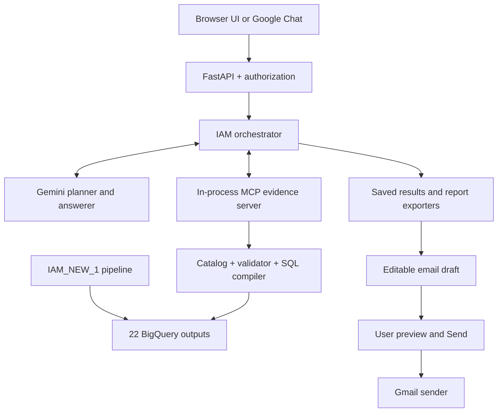

# Conversational IAM analytics, reports, and reviewed email

This repository turns the 22 BigQuery outputs produced by
[`sasidharmeka/IAM_NEW_1`](https://github.com/sasidharmeka/IAM_NEW_1) into a
conversational IAM analyst. A user can ask broad questions such as:

- "Which users have the highest risk scores?"
- "Why is user12 risky?"
- "Compare MFA bypasses by application."
- "What changed for user12 in the last 30 days?"
- "Which Finance identities show role drift?"
- "What is shadow access?"
- "Export the ten riskiest users as Excel and PDF."

After conversation-action resolution, new analyses search all 22 MCP catalog entries using the question
and relevant conversation history. It retrieves candidate schemas across multiple domains and
derives evidence requirements independently of Gemini. Gemini creates a typed semantic plan.
The MCP evidence service checks both question coverage and SQL safety, applies the user's
hierarchy scope, compiles parameterized `SELECT` statements, checks their estimated BigQuery
cost, and returns evidence. Gemini then explains that evidence in ordinary conversation.
The browser retains completed analyses so "download this" exports that exact result without
new table selection. CSV, Excel, PDF, Word, and PowerPoint are supported. Suggested next
questions are buttons that send the question when clicked. Gemini can draft a report or email;
the user edits the recipient, message, and actual attachments, previews them, and explicitly
clicks Send before Gmail is called. See [the 3.4 upgrade steps](DEPLOYMENT.md#updating-an-already-working-deployment-to-34).

IAM analysis remains read-only: no remediation agent, IAM mutation tool, Cloud SQL dependency,
or database secret is used. Gmail sending is a separate, explicitly confirmed action from the
signed-in user's mailbox. The model cannot call the send endpoint.

## Interfaces

| Interface | Authentication | Intended users |
| --- | --- | --- |
| Browser UI at the Cloud Run base URL | Google Identity Services ID token | Personal Gmail or Workspace accounts listed in `WEB_ANALYST_PRINCIPALS` |
| Optional Google Chat app | Google Chat OIDC token plus sender allowlist | Workspace users listed in `CHAT_ANALYST_PRINCIPALS` |

Both interfaces call the same FastAPI handler, orchestrator, MCP tools, and BigQuery controls.

## System at a glance



The MCP client and server use the official MCP Python SDK. They run in the same Cloud Run
container, so MCP is a real protocol boundary without the cost or operational complexity of a
second service. The tool contract can later be moved to a separate service without changing
Gemini's semantic plan format.

## What is deterministic and what uses Gemini

| Component | Responsibility |
| --- | --- |
| Conversation action resolver | Uses message history and saved result/file manifests to distinguish analysis, export, explanation, and email drafts before domain routing |
| Saved result store | Keeps exact evidence and report IDs scoped to the signed-in user and conversation |
| Catalog retriever | Searches all concepts before semantic query planning; combines topic aliases, descriptions, fields, and typo-tolerant matches; retains multiple candidates |
| Gemini question planner | Resolves follow-ups and classifies general/data/mixed questions using already-retrieved schemas; domain labels do not gate data access |
| MCP catalog tools | Expose approved domain, concept, field, dimension, metric, and grain descriptions |
| Gemini query planner | Produces `AnalysisPlan` JSON using catalog vocabulary only |
| Pydantic models | Reject malformed or structurally unsafe plans |
| Time policy | Uses all retained dates by default; removes date filters Gemini adds without a user-requested period |
| Standard plans | Compiles an unambiguous highest-risk ranking into a governed semantic plan without model-generated plan JSON |
| Query validator | Enforces catalog membership, organizational scope, row/step ceilings, and valid filters/sorts |
| Evidence coverage validator | Independently checks matched topics, explicit identity filters, and required explanatory fields before any SQL executes |
| SQL compiler | Maps trusted concepts and metrics to fixed tables and SQL expressions; the only code that creates SQL |
| BigQuery executor | Dry-runs each query, enforces bytes billed, executes read-only SQL, and returns rows |
| Gemini answerer | Explains only the returned evidence and cites only queried outputs |
| Report author | Drafts executive summary, findings, interpretation, priorities, and limits from saved evidence |
| Report exporters | Render CSV/XLSX/PDF/DOCX/PPTX from that evidence; no new BigQuery query or executable formulas |
| Email preview service | Validates recipient/ownership, freezes reviewed text and attachment bytes, and issues a review token |
| Gmail sender | Checks the sending account, accepts only a confirmed frozen draft, and prevents automatic retries |

Gemini can choose among allowed analytical building blocks, but cannot invent a table, metric
expression, SQL fragment, or write operation.

## Repository layout

```text
iam_agent/
  api.py                 FastAPI wiring and HTTP routes
  authentication.py      Google web and Google Chat token verification
  authorization.py       Principal allowlist and hierarchy scopes
  planner.py             Gemini decomposition and semantic planning
  gemini_contracts.py    Simple provider schemas converted into strict application models
  standard_plans.py      Governed plans for straightforward highest-risk rankings
  answerer.py            General and evidence-grounded responses
  orchestrator.py        Conversation workflow
  mcp_client.py           Official in-process MCP client
  conversation.py        Bounded in-memory follow-up context
  actions.py             Structured action and reference understanding before domain selection
  conversation_actions.py Export, explanation, and email-draft workflows over saved results
  result_store.py        Owner/conversation-scoped analysis snapshots
  reporting.py           CSV/XLSX/PDF/DOCX generation and short-lived file storage
  slide_report.py        Native PowerPoint reports and evidence-based risk charts
  email_service.py       Frozen previews, Gmail account verification, and confirmed sends

iam_mcp/
  server.py              Four read-only MCP tools
  catalog.py             Semantic catalog loader
  retrieval.py           Whole-catalog candidate retrieval and evidence coverage checks
  time_policy.py         Explicit-date policy, with all retained history as the default
  validator.py           Plan, authorization, and resource validation
  compiler.py            Deterministic semantic-plan-to-SQL compiler
  bigquery_executor.py    Dry run, byte cap, and query execution
  service.py             MCP application service

config/
  semantic_catalog.yaml  All 22 pipeline outputs and their schemas/descriptions
  identities.yaml        Demo identity-to-hierarchy mapping
  authorization.yaml     Local fallback principal mapping
```

## MCP tools

| Tool | Input | Result | BigQuery access |
| --- | --- | --- | --- |
| `list_iam_domains` | None | Five routing cards covering all 22 concept names, meanings, entities, grains, and synonyms | None |
| `describe_iam_domains` | Selected domains | Relevant concepts, schemas, metrics, and rules | None |
| `search_iam_catalog` | Verified principal, original question, and bounded history | Candidate schemas, domains, matched topics, and evidence requirements | None |
| `run_iam_query` | Verified principal, original question/history, and typed `AnalysisPlan` | `EvidenceBundle` | Bounded `SELECT` only |

Gemini does not directly call BigQuery. The orchestrator makes MCP calls on Gemini's behalf and
passes the returned metadata/evidence back into Gemini's next structured-output call.

The planner receives candidate schemas before domain selection. An incorrect or empty domain
label cannot hide those schemas. Strong question matches become deterministic evidence
requirements: a login question needs authentication evidence; a broad user profile needs risk
scores and timelines; risk explanations need `risk_factors`. MCP recomputes these requirements
from the original question before executing a plan. A safe query against an unrelated table is
rejected. One repair attempt receives the entire catalog and the rejection reason, then passes
through all checks again. Ambiguous retrieval also keeps the entire small catalog available.

This first retrieval reads trusted catalog metadata, not private BigQuery rows. Actual rows are
retrieved only after the plan passes scope, coverage, SQL, and cost checks. Catalog matching is
not a proof of understanding every possible question; unfamiliar terminology can still need
clarification or a catalog alias. Gemini retains responsibility for analytical reasoning.

## Browser report exports

Ask for one or several formats in the same message:

- "Show the riskiest users by application and export as CSV."
- "Analyze user16 and give me Excel and PDF reports."
- "Compare MFA bypasses by application in a Word document."
- "Export this analysis in all report formats."

The browser displays one authenticated download button per requested format. Files contain the
answer, findings, sources, caveats, and the returned evidence rows. Spreadsheet-like text is
escaped to prevent formula injection. Downloads are bound to the Google account that created
them, kept only in the running instance's memory, and expire after 15 minutes. They are intended
for immediate download and require no Cloud SQL, GCS bucket, secret, or new environment variable.

## Five catalog domains

The 22 outputs are tagged into these discoverable topics. A concept can appear in more than one
domain when it supports cross-domain questions.

| Domain | Examples of covered evidence |
| --- | --- |
| `identity_risk` | Risk scores, cleanest users, suspicious sequences, high-impact findings |
| `authentication` | Impossible login/travel, MFA bypass, MFA drift, time-warp events |
| `access_and_provisioning` | Role drift, stale access, privilege escalation, rejected-but-executed, shadow access |
| `application_behavior` | Multi-app sessions, data transfer, application sequences, application usage |
| `lifecycle_and_data_quality` | Orphan users/events, identity timelines, governance completeness |

The catalog records each output's physical schema, business meaning, row grain, time field,
user field, safe dimensions, safe filters, metrics, synonyms, and default display fields.

Questions without an explicit date range query all retained history, including year-old data.
There is no automatic last-30-days filter or maximum lookback restriction. Explicit date requests
still work, subject to the same authorization and byte limits. The plain "which users are the
riskiest" request uses a fixed semantic ranking plan with `maximum_risk_score` grouped by `user`.
Gemini explains the resulting evidence. Additional constraints, comparisons, and other questions
continue through the general planning path. Historical scores are not presented as current risk.

## Quick deployment

The complete first-time commands, GitHub variables, OAuth setup, verification commands, and
troubleshooting guide are in [DEPLOYMENT.md](DEPLOYMENT.md). The shortest path is:

```bash
git clone https://github.com/sasidharmeka/multi-agent-iam-demo.git
cd multi-agent-iam-demo
chmod +x setup_iam_agent.sh
./setup_iam_agent.sh 2>&1 | tee ~/setup_iam_agent.log
```

Then set the GitHub Environment variables printed by the script and run
**Actions > Deploy read-only IAM agent > Run workflow**.

## Local tests

```bash
python3 -m venv .venv
source .venv/bin/activate
python -m pip install -r requirements-dev.txt
ruff check iam_agent iam_mcp tests main.py
pytest -q
```

Local end-to-end execution also needs Application Default Credentials with access to Gemini and
the BigQuery dataset. Copy `.env.example` to `.env`, fill in the web identity settings if needed,
then run:

```bash
uvicorn main:app --reload --port 8080
```

## Important data limitation

The agent can answer arbitrary questions that can be supported by the 22 outputs. It can also
answer general IAM questions without claiming they describe this project. It cannot truthfully
answer project-specific questions when the needed fact is absent from those outputs; in that
case it reports the gap. Some pipeline jobs overwrite their output tables, so a request for a
long historical trend is possible only when the relevant table actually retains that history.
Exporting a response changes its format, not the amount or scope of evidence available.

See [ARCHITECTURE.md](ARCHITECTURE.md) for the full technical sequence and safety invariants.

## Conversation actions in 3.4

The browser sends a per-tab conversation ID with each message. Clicking a suggested question
also sends the originating result ID. After authentication and query authorization, the action
resolver receives the current message, bounded conversation history, and saved result manifests
containing the original question, plan, answer, and actual report IDs.

A clear "download this" request takes the existing result directly to an exporter. For more
complex follow-ups, Gemini returns a typed action and a standalone resolved question. The app
checks referenced result/file IDs against the same user's conversation. New evidence requests
continue through catalog retrieval, deterministic coverage/authorization validation, query
compilation, BigQuery execution, and answer generation.

Report generation preserves the canonical analysis: "your file is ready" does not replace the
saved evidence or answer. Ordinary CSV/Excel downloads do not need another Gemini call.
Detailed reports and richer document formats can invoke the report author over those saved
facts. Generated files use authenticated owner-bound download endpoints.

An email action creates only an application draft. Selecting Preview posts the edited recipient,
subject, body, and attachment IDs to `/web/email/{draft_id}/preview`. The service validates them
and freezes the exact bytes under a review token. Only the separate Send button obtains a
short-lived Gmail access token and calls `/web/email/{draft_id}/send` with that review token
and explicit confirmation. The endpoint cannot accept a replacement recipient/body/file list.
It verifies that the Gmail sender matches the app login, then constructs and sends the MIME
message. A duplicate request returns the existing receipt or a conflict; an uncertain send is
locked and never automatically retried.

The model is useful for interpreting language; the deterministic code governs identity, data
scope, valid references, query structure, export formats, and the transition from preview to
send. MCP coverage and time-policy validation continue to receive the original user message,
so a model rewrite cannot make a model-invented time period count as an explicit user request. The application does not infer authorization from chat history or model output.

## Validation

The CI workflow runs Ruff, Python regression tests, and a separate Chromium browser job.
The browser job uses fictitious Google identity, analysis, and email responses, blocks outbound
Google requests, and checks automatic suggestion submission plus the full draft/preview/Send
interaction. Python tests exercise real MCP/SDK contracts with simulated model and BigQuery
responses, exact export values, ownership/expiry, MIME attachments, review-token binding,
account mismatch, and duplicate/uncertain send behavior. No test sends real email.

To run the browser checks separately:

~~~bash
python -m pip install "playwright>=1.55,<2"
python -m playwright install chromium
python -m unittest discover -s ui_tests -v
~~~

Live Gemini, BigQuery, Google consent, and Gmail sending still require the deployment's actual
Google configuration. Follow the manual verification sequence in [DEPLOYMENT.md](DEPLOYMENT.md).
