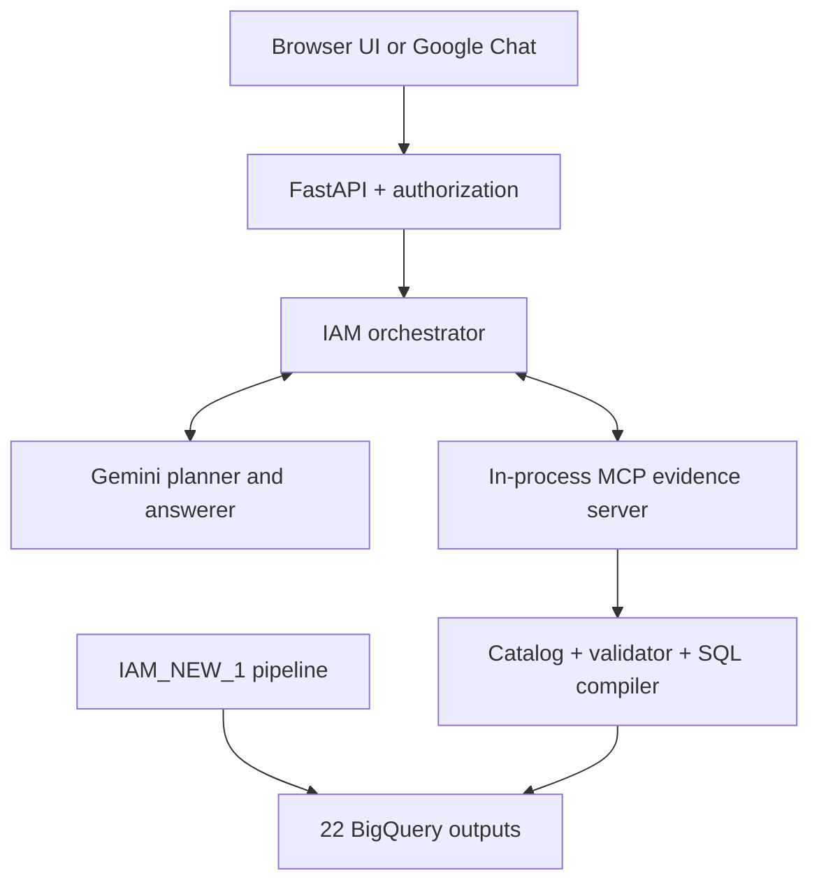

# Read-only conversational IAM analytics agent

This repository turns the 22 BigQuery outputs produced by
[`sasidharmeka/IAM_NEW_1`](https://github.com/sasidharmeka/IAM_NEW_1) into a
conversational IAM analyst. A user can ask broad questions such as:

- "Which users have the highest risk scores?"
- "Why is user12 risky?"
- "Compare MFA bypasses by application."
- "What changed for user12 in the last 30 days?"
- "Which Finance identities show role drift?"
- "What is shadow access?"

Gemini understands the question and creates a typed semantic plan. It never writes SQL. The
MCP evidence service validates the plan against a versioned catalog, applies the user's
hierarchy scope, compiles parameterized `SELECT` statements, checks their estimated BigQuery
cost, and returns evidence. Gemini then explains that evidence in ordinary conversation.

This version is intentionally read-only. It contains no remediation agent, approval gateway,
action queue, deterministic IAM mutation tool, Cloud SQL dependency, or database secret.

## Interfaces

| Interface | Authentication | Intended users |
| --- | --- | --- |
| Browser UI at the Cloud Run base URL | Google Identity Services ID token | Personal Gmail or Workspace accounts listed in `WEB_ANALYST_PRINCIPALS` |
| Optional Google Chat app | Google Chat OIDC token plus sender allowlist | Workspace users listed in `CHAT_ANALYST_PRINCIPALS` |

Both interfaces call the same FastAPI handler, orchestrator, MCP tools, and BigQuery controls.

## System at a glance



The MCP client and server use the official MCP Python SDK. They run in the same Cloud Run
container, so MCP is a real protocol boundary without the cost or operational complexity of a
second service. The tool contract can later be moved to a separate service without changing
Gemini's semantic plan format.

## What is deterministic and what uses Gemini

| Component | Responsibility |
| --- | --- |
| Gemini question planner | Resolves follow-ups, classifies general/data/mixed questions, and selects IAM domains |
| MCP catalog tools | Expose approved domain, concept, field, dimension, metric, and grain descriptions |
| Gemini query planner | Produces `AnalysisPlan` JSON using catalog vocabulary only |
| Pydantic models | Reject malformed or structurally unsafe plans |
| Query validator | Enforces catalog membership, organizational scope, row/time/step ceilings, and valid filters/sorts |
| SQL compiler | Maps trusted concepts and metrics to fixed tables and SQL expressions; the only code that creates SQL |
| BigQuery executor | Dry-runs each query, enforces bytes billed, executes read-only SQL, and returns rows |
| Gemini answerer | Explains only the returned evidence and cites only queried outputs |

Gemini can choose among allowed analytical building blocks, but cannot invent a table, metric
expression, SQL fragment, or write operation.

## Repository layout

```text
iam_agent/
  api.py                 FastAPI wiring and HTTP routes
  authentication.py      Google web and Google Chat token verification
  authorization.py       Principal allowlist and hierarchy scopes
  planner.py             Gemini decomposition and semantic planning
  answerer.py            General and evidence-grounded responses
  orchestrator.py        Conversation workflow
  mcp_client.py           Official in-process MCP client
  conversation.py        Bounded in-memory follow-up context

iam_mcp/
  server.py              Three read-only MCP tools
  catalog.py             Semantic catalog loader
  validator.py           Plan, authorization, and resource validation
  compiler.py            Deterministic semantic-plan-to-SQL compiler
  bigquery_executor.py    Dry run, byte cap, and query execution
  service.py             MCP application service

config/
  semantic_catalog.yaml  All 22 pipeline outputs and their schemas/descriptions
  identities.yaml        Demo identity-to-hierarchy mapping
  authorization.yaml     Local fallback principal mapping
```

## MCP tools

| Tool | Input | Result | BigQuery access |
| --- | --- | --- | --- |
| `list_iam_domains` | None | Five compact domain descriptions | None |
| `describe_iam_domains` | Selected domains | Relevant concepts, schemas, metrics, and rules | None |
| `run_iam_query` | Verified principal plus typed `AnalysisPlan` | `EvidenceBundle` | Bounded `SELECT` only |

Gemini does not directly call BigQuery. The orchestrator makes MCP calls on Gemini's behalf and
passes the returned metadata/evidence back into Gemini's next structured-output call.

## Five catalog domains

The 22 outputs are tagged into these discoverable topics. A concept can appear in more than one
domain when it supports cross-domain questions.

| Domain | Examples of covered evidence |
| --- | --- |
| `identity_risk` | Risk scores, cleanest users, suspicious sequences, high-impact findings |
| `authentication` | Impossible login/travel, MFA bypass, MFA drift, time-warp events |
| `access_and_provisioning` | Role drift, stale access, privilege escalation, rejected-but-executed, shadow access |
| `application_behavior` | Multi-app sessions, data transfer, application sequences, application usage |
| `lifecycle_and_data_quality` | Orphan users/events, identity timelines, governance completeness |

The catalog records each output's physical schema, business meaning, row grain, time field,
user field, safe dimensions, safe filters, metrics, synonyms, and default display fields.

## Quick deployment

The complete first-time commands, GitHub variables, OAuth setup, verification commands, and
troubleshooting guide are in [DEPLOYMENT.md](DEPLOYMENT.md). The shortest path is:

```bash
git clone https://github.com/sasidharmeka/multi-agent-iam-demo.git
cd multi-agent-iam-demo
chmod +x setup_iam_agent.sh
./setup_iam_agent.sh 2>&1 | tee ~/setup_iam_agent.log
```

Then set the GitHub Environment variables printed by the script and run
**Actions > Deploy read-only IAM agent > Run workflow**.

## Local tests

```bash
python3 -m venv .venv
source .venv/bin/activate
python -m pip install -r requirements-dev.txt
ruff check iam_agent iam_mcp tests main.py
pytest -q
```

Local end-to-end execution also needs Application Default Credentials with access to Gemini and
the BigQuery dataset. Copy `.env.example` to `.env`, fill in the web identity settings if needed,
then run:

```bash
uvicorn main:app --reload --port 8080
```

## Important data limitation

The agent can answer arbitrary questions that can be supported by the 22 outputs. It can also
answer general IAM questions without claiming they describe this project. It cannot truthfully
answer project-specific questions when the needed fact is absent from those outputs; in that
case it reports the gap. Some pipeline jobs overwrite their output tables, so a request for a
long historical trend is possible only when the relevant table actually retains that history.

See [ARCHITECTURE.md](ARCHITECTURE.md) for the full technical sequence and safety invariants.
