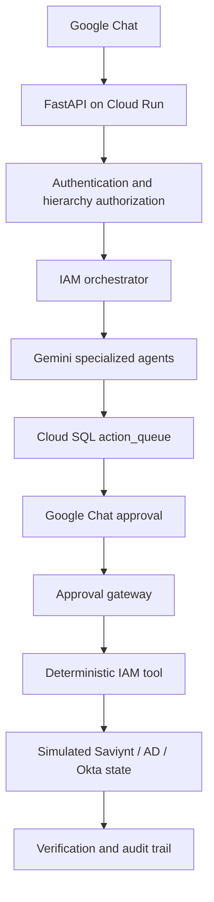

# IAM Agent Platform

Gemini-based IAM investigation and human-approved remediation service for Google Chat.
This repository is the agent layer for the analytics produced by
[`sasidharmeka/IAM_NEW_1`](https://github.com/sasidharmeka/IAM_NEW_1).

The original regulatory-scanning/Telegram demo has been replaced by this workflow:



## What is implemented

- FastAPI endpoint for `MESSAGE`, `ADDED_TO_SPACE`, `REMOVED_FROM_SPACE`, and
  `CARD_CLICKED` Google Chat events.
- Google Chat request authentication through Cloud Run IAM, with optional in-app OIDC
  verification.
- Role and hierarchy authorization (`viewer`, `analyst`, `approver`, `admin`).
- Read-only, parameterized access to 18 user-scoped BigQuery outputs from `IAM_NEW_1`.
- Investigation, policy/RAG, impact, and remediation agents using Gemini structured output.
- Concurrent investigation/policy/impact calls; remediation waits for all three results.
- PostgreSQL/Cloud SQL `action_queue`, `audit_events`, and simulated IAM state.
- Approve/reject cards in Google Chat, separation of duties, idempotency, and strict action
  state transitions.
- Deterministic simulated execution for AD group removal, Saviynt access revocation, Okta
  MFA reset, and Okta identity suspension.
- Post-execution verification. Gemini cannot directly call an execution tool.

## Analytics input

`IAM_NEW_1` remains a separate upstream pipeline:

```text
Okta / Saviynt / AD / application activity / HR lifecycle
    -> Pub/Sub and GCS
    -> Spark transformations and IAM detections
    -> BigQuery iam_data_dev tables
    -> this service reads evidence by target identity
```

The BigQuery adapter uses a fixed table allowlist and named query parameters. It never
executes SQL written by Gemini and never writes to BigQuery. The two main summary inputs
are `risk_scores` and `identity_timelines`; anomaly evidence includes authentication,
access/provisioning, application behavior, orphan, and time-warp detections.

## Safety model

1. The authenticated Chat user must have `investigate` permission for the target's
   organizational path.
2. Gemini returns Pydantic-validated output and can choose only a fixed operation enum.
3. The exact resource must appear in collected evidence for group or entitlement removal.
4. The immutable plan is inserted with status `PENDING_APPROVAL`.
5. A different human with `approve` permission over the target scope must click a button.
6. The approval gateway runs the previously stored plan; it does not ask Gemini again.
7. A fixed operation-to-tool map changes simulated state, verifies it, and appends audit
   events.

`no_action` is a valid Gemini recommendation. It never creates an approval request.

## Project layout

```text
main.py                         Cloud Run / Uvicorn entry point
iam_agent/api.py                FastAPI app and dependency wiring
iam_agent/chat.py               Google Chat event and card handling
iam_agent/authentication.py     Optional OIDC token verification
iam_agent/authorization.py      Role + hierarchy enforcement
iam_agent/orchestrator.py       Agent workflow and safety validation
iam_agent/evidence.py           BigQuery allowlisted evidence queries
iam_agent/policy_rag.py         Version-controlled policy retrieval
iam_agent/agents/               Four specialized Gemini agents
iam_agent/repository.py         Cloud SQL action/audit/simulation persistence
iam_agent/execution.py          Approval gateway + deterministic execution
config/authorization.yaml       Chat principals, roles, and scopes
config/identities.yaml          IAM identity organizational paths
policies/iam_policy.md          Demo RAG policy corpus
sql/schema.sql                  PostgreSQL schema reference
tests/                          Offline unit tests
```

## Local setup

Python 3.11 or newer is required.

```bash
python3 -m venv .venv
source .venv/bin/activate
pip install -r requirements-dev.txt
cp .env.example .env
gcloud auth application-default login
uvicorn main:app --reload
```

For local use, either replace the example principals in `config/authorization.yaml` or set
`CHAT_ANALYST_PRINCIPALS` and `CHAT_APPROVER_PRINCIPALS` in `.env`. Deployment uses the
environment variables, so no authorization file edit is required.

Run the offline validation suite:

```bash
ruff check iam_agent tests main.py
python -m pytest -q
```

The tests do not call Gemini, BigQuery, Google Chat, or GCP.

## One-click Cloud Run deployment

The repository includes `.github/workflows/deploy-agent.yml`. After its GitHub Environment
variables are configured, use **Actions > Deploy IAM Agent > Run workflow**. The workflow
runs tests, authenticates using WIF, deploys the private scale-to-zero Cloud Run service,
connects Cloud SQL and Secret Manager, grants Google Chat invocation access, and prints the
Chat endpoint in the job summary.

See [DEPLOYMENT.md](DEPLOYMENT.md) for the exact variable list, one-time IAM prerequisites,
Cloud SQL secret format, WIF repository binding, and Google Chat registration steps.

### Manual alternative

The runtime service account needs only:

- Vertex/Gemini inference permission for the selected model platform.
- `roles/bigquery.jobUser` on the project and BigQuery Data Viewer on `iam_data_dev`.
- `roles/cloudsql.client` for the selected Cloud SQL PostgreSQL instance.
- Secret Manager access only when `DATABASE_URL` is injected from a secret.

Example deployment (replace the uppercase placeholders):

```bash
gcloud run deploy iam-agent \
  --source . \
  --project rapid-stage-506406-t4 \
  --region us-central1 \
  --service-account IAM_AGENT_RUNTIME_SERVICE_ACCOUNT \
  --no-allow-unauthenticated \
  --add-cloudsql-instances rapid-stage-506406-t4:us-central1:CLOUD_SQL_INSTANCE \
  --set-env-vars BIGQUERY_PROJECT=rapid-stage-506406-t4,BIGQUERY_DATASET=iam_data_dev,GOOGLE_CLOUD_LOCATION=us-central1,GEMINI_MODEL=gemini-2.5-flash \
  --set-secrets DATABASE_URL=IAM_AGENT_DATABASE_URL:latest

gcloud run services add-iam-policy-binding iam-agent \
  --project rapid-stage-506406-t4 \
  --region us-central1 \
  --member serviceAccount:chat@system.gserviceaccount.com \
  --role roles/run.invoker
```

In Google Chat API configuration:

1. Enable interactive features.
2. Select an HTTP endpoint.
3. Use `https://YOUR_CLOUD_RUN_URL/google-chat/events` as the endpoint.
4. Use the HTTP endpoint URL authentication audience.
5. Restrict visibility to your test users or Workspace group.

Google Chat requires a synchronous response within 30 seconds. The three independent
analysis agents run concurrently to keep the demo within that window. If real datasets or
models make the request slower, move investigation to Cloud Tasks and post the final card
asynchronously through the Chat API.

## Current execution boundary

The final connectors deliberately modify `simulated_iam_state`, not real Saviynt, AD, or
Okta. Replacing a simulator with a real connector should preserve the same typed operation
contract, approval state machine, resource validation, verification, and audit calls.

See [ARCHITECTURE.md](ARCHITECTURE.md) for the detailed execution trace and trust
boundaries.
